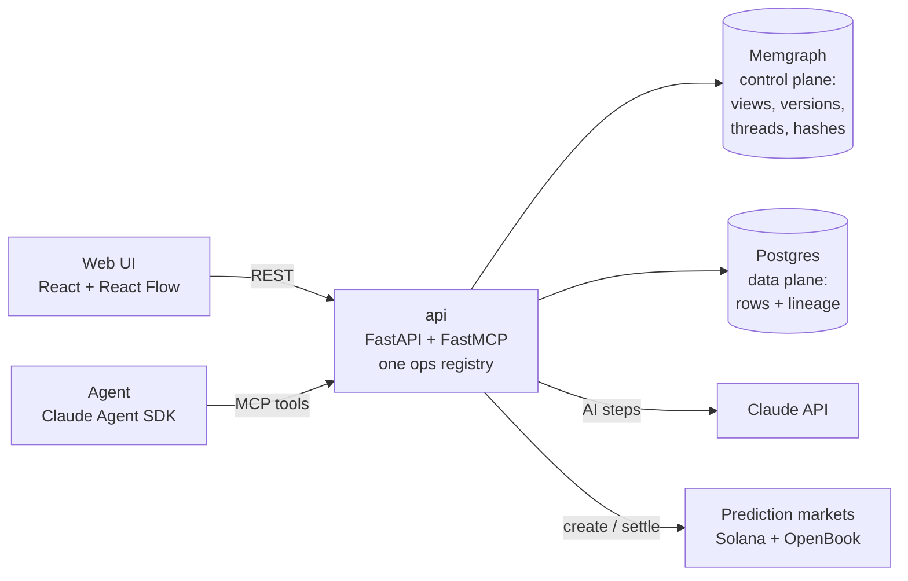

# Backtrace

**Answers you can take apart.** Ask a question about public data. Backtrace agrees the shape of the answer with you, finds and loads the data, and computes it. Every number traces back to the source rows it came from, and every step is a hash you can re-check.

> HTB26 hackathon · live demo: **https://backtrace.dvstr.net** (access code in our submission notes)

---

## The problem

Dashboards and AI assistants hand you a number, but you can't see how it was made. "Flat prices in Reading went up 4%": which sales were counted? What was dropped? Was it a median or a mean, and did an LLM make it up? You either trust it or redo the work yourself.

## What Backtrace does

You start with a question, e.g. *"Which US airlines had the worst delays in 2025?"*, and work through four steps with the agent:

| Step | What happens | What you see |
|---|---|---|
| **Ask** | The question becomes a research workspace. | A question node on the canvas, plus a floating chat. |
| **Shape** | The agent proposes what the answer looks like: its columns, what one row means, scope and units, with preview rows. | A table node with the proposal as a diff you can accept, discard or comment on. |
| **Data** | The agent picks a dataset from a curated catalog, loads it, and proposes the steps that turn it into your table. | Source data on the shelf at the bottom, and the steps as a proposal on the table. |
| **Answer** | Once you approve, the steps run. The answer is written under the question, with a chart if it helps. | The question node shows the answer; click any row to trace it. |

Then you can **look into the future**: turn a row of the answer into a prediction market that settles itself from the same calculation when new data arrives.

### What makes it different

- **Every number has a receipt.** Each row carries the ids of the rows it came from, all the way down to the raw CSV lines, even through aggregations. Click a value to walk its lineage.
- **Every result is a hash.** Each table's hash covers its data, the exact formula and the hashes of its inputs, so one hash commits to the whole chain. **Verify** recomputes everything from the stored rows and compares. AI-written steps are hashed by their stored output and labelled as such.
- **The work is code you can read.** Each table opens as a notebook of plain pandas cells, one per step. Edit a step as Python and re-run it, or export the chain as `.py` or `.ipynb` and run it yourself.
- **You stay in control, or not.** Approve each step, or switch on **auto-accept** and get taken straight to the answer. **Fast track** appears when the agent takes longer than a few seconds; it sends you off to a deliberately silly ADHD tab and pings you when the answer lands.
- **Replay any workspace.** Step through how the answer was reached: every proposal, approval, revision, note and computed table, with the camera following along. It ends back on the live workspace, so you can carry on exploring.
- **Nothing is overwritten.** Proposals are immutable and decisions are append-only. Discarded ideas and old versions stay on the graph, which is what makes replay possible.

## Demo walkthrough (3 minutes)

1. Open the site and pick an example question under a dataset card, e.g. *"Which US airlines had the worst delays in 2025?"* Leave **Auto-accept** on.
2. Watch the canvas fill in: the question, the table's shape, the source data, then the steps. After 5 seconds you can hit **⚡ Fast track** and come back when you're pinged.
3. The answer appears under the question. Click a row in the table to trace it back to the airline-month rows it was computed from.
4. Click **⟨/⟩** on the table to open its notebook. Press **Verify** and the chain's hashes are recomputed and matched.
5. Ask a follow-up in the chat, e.g. *"Now do 2024"*. A second question joins the same workspace and reuses the loaded data.
6. Press **⟲ Replay** to watch the whole session back, step by step.
7. Optional: on an answer row, use **Ask the market** to draft a prediction market on next year's value.

## How it works



- **One graph is the only state.** Memgraph holds the views, their shape, step and visual versions, the research threads, and the data manifests and hashes. Rows live in Postgres: append-only raw tables per source, one table per computed result, each row tagged with `_src`, its lineage.
- **One set of operations, two front doors.** Every operation is registered once and exposed as both **MCP tools** (for the agent) and **REST** (for the UI). The agent has no powers the UI lacks, and it never relies on its own memory: the graph is the record.
- **The agent is Claude**, run with the Claude Agent SDK inside the api. Its tools are the backtrace MCP tools, and its skills live in [`agent/.claude/skills/`](agent/.claude/skills/), e.g. question → shape, find dataset, reverse step. You pick **Haiku 5.5**, **Sonnet 5.5** or **Opus 5.5** per workspace; Haiku is the default and costs about a tenth of a cent per turn.
- **Steps (transforms)** are pure functions from input rows to output rows:
  - **deterministic ops:** filter, derive, aggregate. They're declarative, written by the agent, and compiled to pandas.
  - **Python:** an escape hatch for anything the ops can't express.
  - **AI steps:** map or reduce with Claude, using the table's JSON Schema as structured input and output. Their outputs are cached and hashed, so they replay but can't silently change.
- **Hashes:** a chunked Merkle root over each result's rows, combined with a formula hash (shape + step spec + engine + input formula hashes) and the input results' hashes. A source's hash includes the sha256 of the raw file.
- **Markets** (by MIDAV0, in [`prediction-market/`](prediction-market/README.md)): binary YES/NO markets on a local Solana validator, with OpenBook v2 order books, mock-USDC collateral and market-making bots. Backtrace defines what a market is about, pins the exact calculation, and settles it by re-running that calculation when its end date passes.

More detail: [BRIEF.md](BRIEF.md) (the idea), [docs/SPEC.md](docs/SPEC.md) (graph model, ops, UI), [docs/BRIEF-data-plane.md](docs/BRIEF-data-plane.md) (storage and hashes), [docs/BRIEF-markets.md](docs/BRIEF-markets.md) (markets).

## Data

The agent offers datasets from a small curated catalog ([`api/app/datasets.json`](api/app/datasets.json)):

| Dataset | Publisher | Licence |
|---|---|---|
| [Price Paid Data](https://www.gov.uk/government/statistical-data-sets/price-paid-data-downloads) (2023–2025) | HM Land Registry | Open Government Licence v3.0 |
| [Airline On-Time Performance & Delay Causes](https://www.transtats.bts.gov/OT_Delay/OT_DelayCause1.asp) | US Bureau of Transportation Statistics | Public domain |

We also loaded EPC energy certificates (757k rows) into Postgres with a standalone streaming loader ([`scripts/load_big_csv.py`](scripts/load_big_csv.py)) to try the design at a larger scale.

## Run it

You need Docker, an Anthropic API key, and a Postgres database for the rows (any hosted Postgres works).

```bash
git clone https://github.com/ShapeShiftersHTB26/HTB26.git && cd HTB26
python scripts/setup_env.py                 # writes .env: API key, PG_DSN, models (secrets are never echoed)
# put the catalog CSVs in data/raw/: pp-2023.csv … pp-2025.csv, Airline_Delay_Cause.csv
docker compose up -d --build memgraph lab api web
```

Then open http://localhost:5173. Memgraph Lab is at http://localhost:3000 if you want to look at the graph itself.

- **Prediction markets** need the `prediction-market-*` services as well (`docker compose up -d --build`). The first build compiles a Solana program and takes a while.
- **A server deploy** with HTTPS (Caddy), an access-code gate and state export/import is described in [docs/DEPLOY.md](docs/DEPLOY.md).

## Built with

Claude (Agent SDK, MCP, structured outputs) · FastAPI + FastMCP · Memgraph · Postgres · pandas · React + Vite + React Flow · Solana, Anchor and OpenBook v2 · Rust (axum) · Docker + Caddy

## Limitations and next steps

- **Verified computation, not verified sources.** The hashes prove the answer was computed correctly from the stored rows and the named file, not that the publisher's file is true.
- **AI steps can be replayed but not recomputed.** Verify reports them as such, and markets only settle on deterministic chains.
- **Big tables skip the full re-check.** Above 100k rows, verify skips the row-by-row recompute to keep the demo fast.
- **Market settlement is signed by an admin key.** It's auditable, because anyone can re-run the pinned calculation, but not trustless. Next: commit the formula and proof hashes on chain, and add a dispute window.
- **Next:** joins across datasets, more catalog sources, and pushing filters down into SQL for large sources.

## Team

**ShapeShifters**: Ploven (Backtrace: graph model, agent, research UI, data plane, hashing) and MIDAV0 (prediction markets: Solana program, order books, market backend, Predictions tab).
